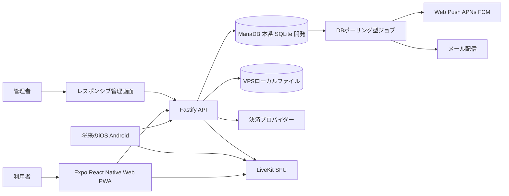

# まんぞうラブ プロダクト仕様書

| 項目 | 内容 |
| --- | --- |
| プロダクト名 | まんぞうラブ |
| 対象 | マン組のファン向け公式アプリと運営管理画面 |
| 初期提供形態 | Webアプリ、PWA対応 |
| 将来提供形態 | iOSアプリ、Androidアプリ |
| 文書状態 | Draft 0.1 |
| 作成日 | 2026年10月2日 |

## この仕様書の目的

本書は、YouTuberグループ「マン組」の公式ファンアプリ「まんぞうラブ」を実装するための初期仕様を定義する。初回リリースはPWAとし、会員登録、配信予定、通知、運営管理を先に成立させる。その後、ストーリー、DM、音声ルーム、投げ銭、課金プラン、ガチャを段階的に追加し、最終的にiOSとAndroidへ展開する。

利用者向けアプリはExpoを用いたReact Native／React Native Webで実装し、Webと将来のネイティブアプリで画面ロジックを共有する。管理画面も同じPWA内の管理者専用ルートとして実装し、認証、API、型定義、権限判定、デザイン要素を共通化する。

本書に記載する金額、通知時刻、保存期間、上限数は、明記がない限り管理画面で変更可能な設定値とする。法令、決済事業者、App Store、Google Playの審査方針に関わる機能は、公開前に最新条件を再確認する。

## プロダクト方針

- 会員登録直後は全員をFreeプランに所属させる。
- すべての利用者向け機能は、プランごとに利用可否と上限値を設定できるようにする。
- PWA未インストールの利用者には、端末とブラウザに合った画像付きインストール案内を表示する。
- 通知許可は、ログイン後に目的を説明し、利用者が「通知をONにする」を押した後にだけブラウザへ要求する。
- DM、音声ルーム、投稿メッセージなどのユーザー生成コンテンツには、通報、ブロック、モデレーション、利用停止を最初から組み込む。
- カード番号やセキュリティコードは本システムに保存せず、決済事業者のトークンを使用する。
- ガチャは換金、譲渡、ユーザー間取引を不可とし、有料化前に法務とストア審査条件を確認する。
- 管理操作、権限変更、返金、抽選設定変更は監査ログに残す。

## 対象ユーザーと権限

### 一般利用者

| 役割 | 主な権限 |
| --- | --- |
| 未登録者 | PWA案内、サービス紹介、利用規約、プライバシーポリシー、会員登録、ログイン |
| 未確認会員 | メール再送、メールアドレス変更、ログアウト。その他の機能は利用不可 |
| Free会員 | Freeプランに割り当てられた機能 |
| 有料会員 | 契約中プランに割り当てられた機能と上限 |
| 公式配信者 | ストーリー投稿、音声ルームのホスト、公式アカウントとしてのDM、投げ銭受取対象など、個別に付与された権限 |
| 利用停止会員 | ログイン不可、または閲覧のみ。停止理由と期限は管理画面で設定 |

### 管理者

| 管理ロール | 主な権限 |
| --- | --- |
| スーパー管理者 | 全権限、管理者追加、ロール設定、決済・セキュリティ設定 |
| コンテンツ管理者 | 配信予定、ストーリー、通知、ガチャ景品、ブランド素材 |
| モデレーター | 通報、DM、音声ルーム、ユーザー停止、NGワード |
| サポート担当 | 会員検索、本人確認補助、問い合わせ対応。決済情報の変更は不可 |
| 経理担当 | 課金、投げ銭、返金、売上CSV。DM本文などは閲覧不可 |

管理者は一般会員と別の管理画面からログインする。管理者には二要素認証を必須とし、ロールベースアクセス制御と監査ログを適用する。

## 機能のリリース区分

| 段階 | 目的 | 対象機能 |
| --- | --- | --- |
| Phase 1 | PWAとして安全に公開する | 会員登録、メール確認、ログイン、プロフィール、PWA案内、配信カレンダー、Web Push通知、管理画面、Freeプラン、ブランド設定 |
| Phase 2 | 日常的に開く理由を作る | ストーリー、既読管理、1対1 DM、音声メッセージ、通報とブロック |
| Phase 3 | ファン交流を作る | Xのスペース型音声ルーム、ルーム予定、司会権限、モデレーション |
| Phase 4 | 収益化する | 有料プラン、投げ銭、カード登録、返金、売上管理 |
| Phase 5 | 継続率を高める | ガチャ、コレクション、チケット、キャンペーン、確率履歴 |
| Phase 6 | ストアへ展開する | iOS、Android、ストア課金、APNs／FCM、審査対応 |

課金プランと機能権限のデータ構造はPhase 1で実装する。ただし、初期公開ではFreeプランのみ有効にし、有料決済画面は機能フラグで非表示にする。

## 利用者向け画面構成

### 共通ナビゲーション

モバイルでは下部タブを使用する。PCやタブレットで開いた場合もスマートフォンと同じ縦長UIを画面中央に表示し、利用者画面の最大幅は460pxを基準とする。初期タブは「ホーム」「予定」「スペース」「DM」「マイページ」とし、プランまたは機能フラグで無効な項目は非表示またはロック表示にできる。音声ルーム開催中は、どの画面からでも戻れるミニプレイヤーを表示する。

### 画面一覧

| 分類 | 画面 |
| --- | --- |
| 導入 | PWAインストール案内、サービス紹介、利用規約、プライバシーポリシー |
| 認証 | 会員登録、確認メール送信済み、メール確認完了、ログイン、パスワード再設定 |
| ホーム | お知らせ、次回配信、開催中の音声ルーム、未読DM、最新ストーリー |
| 予定 | 月／週／一覧カレンダー、予定詳細、外部配信リンク、通知設定 |
| ストーリー | ストーリー一覧、閲覧、アーカイブ対象コンテンツ |
| 音声ルーム | 予定一覧、ルーム詳細、参加、登壇申請、開催中UI、終了画面 |
| DM | 会話一覧、1対1会話、テキスト送信、音声録音と送信、通報、ブロック |
| 投げ銭 | 受取人選択、金額選択、カスタム金額、メッセージ、支払方法、完了、履歴 |
| ガチャ | キャンペーン一覧、提供割合、抽選、結果、コレクション、履歴 |
| マイページ | プロフィール、プラン、通知設定、ブロック一覧、支払方法、利用履歴、退会 |

## PWAインストール案内

### 表示条件

初回アクセス時にPWAのスタンドアロン表示ではない場合、端末とブラウザを判定し、画像付き案内を全画面で表示する。案内は閉じられるようにし、閉じた後もホーム上部とマイページから再表示できるようにする。インストール済みと判定できた場合は表示しない。

### 対応パターン

| 環境 | 案内内容 |
| --- | --- |
| iPhone／iPad | 共有ボタン、ホーム画面に追加、追加確定までを実際のUIに近い画像で説明 |
| Android Chrome系 | ブラウザのインストールイベントが使える場合は「アプリをインストール」を表示。使えない場合はメニューからの追加手順を画像で説明 |
| Windows／macOS Chrome系 | アドレスバーまたはメニューからのインストール手順を説明 |
| 未対応ブラウザ | 対応ブラウザへの切替案内と、ブラウザ版を続ける選択肢を表示 |

案内画像はOSとブラウザの主要バージョン別に管理し、管理画面から本文、表示順、画像、対象条件、公開状態を更新できるようにする。古い画像が誤操作を招かないよう、管理画面に最終確認日を表示する。

### PWA要件

- Web App Manifestに名称、短縮名、開始URL、表示モード、テーマ色、背景色、ID、各サイズのアイコンを定義する。
- Service Workerでアプリシェルと安全な静的リソースをキャッシュする。
- 認証情報、DM、決済、ガチャ結果はオフラインキャッシュに保存しない。
- 更新版がある場合は「新しいバージョンがあります」と表示し、利用者の操作で再読込する。
- オフライン時は専用画面を出し、送信操作を成功扱いにしない。

## 会員登録と認証

### 登録項目

| 項目 | 仕様 |
| --- | --- |
| ニックネーム | 必須、2から30文字、禁止語と重複可否を管理設定で制御。初期値は重複可 |
| サムネイル画像 | 必須。JPEG、PNG、WebP。アップロード後に正方形へ切り抜き、複数サイズを生成 |
| 性別 | 必須選択。「男性」「女性」「その他」「回答しない」。公開範囲は非公開を初期値とする |
| メールアドレス | 必須、ログインID、正規化後に一意 |
| パスワード | 必須、12文字以上を推奨初期値とし、漏えいしやすい文字列を拒否 |
| 同意 | 利用規約、プライバシーポリシーへの同意を必須。規約バージョンと日時を保存 |
| 年齢確認 | 投げ銭や有料ガチャの公開前に必須化を判断。初期案は18歳以上であることの申告 |

### 登録フロー

1. 利用者が登録情報と規約同意を送信する。
2. アカウントを「メール未確認」で作成し、Freeプランを付与する。
3. 有効期限付きの一回限りリンクをメールで送る。
4. リンクを開くとメール確認済みに変更し、既存の確認トークンをすべて失効させる。
5. ログイン後、プロフィール確認、通知案内の順にオンボーディングを表示する。

確認メールは再送できるようにし、連続送信にはレート制限を設ける。メールアドレス変更時は新しいアドレスを確認するまで旧アドレスをログインIDとして保持する。パスワードはArgon2idでハッシュ化し、平文では保存しない。

### セッション

- WebはSecure、HttpOnly、SameSite属性付きCookieを基本とする。
- ネイティブ版はOSのセキュアストレージに更新トークンを保存する。
- ログアウト、パスワード変更、管理者による停止時は対象セッションを失効させる。
- マイページからログイン中端末を確認し、端末単位または全端末からログアウトできるようにする。

## プランと機能権限

### プラン設定

管理画面でプラン名、説明、月額、年額、公開状態、申込受付期間、表示順、色、バッジ、無料体験、解約時の扱いを設定できる。Freeプランは削除不可とし、常にフォールバックとして存在させる。

### 機能割当

各機能は、プランごとに次を設定できる。

- 利用可否
- 一日、一週間、一か月あたりの利用回数
- 同時利用数、参加人数、作成数
- ファイル容量、録音秒数、保存期間
- 閲覧のみ、送信可、作成可、管理可などの権限レベル
- 対象となる公式配信者、キャンペーン、コンテンツ

主な機能キーは `calendar.view`、`notification.receive`、`story.view`、`dm.send`、`dm.audio.send`、`voice.join`、`voice.speak`、`voice.create`、`tip.send`、`gacha.draw` とする。機能キーはコード側で登録し、管理画面から名称、説明、プランへの割当、上限値を編集できる。存在しない機能キーを管理者が自由入力しても権限が生まれないようにする。

権限判定は画面表示だけでなく、必ずAPI側でも行う。プラン変更は監査ログを残し、既存会員への適用日時を即時または予約から選べるようにする。個別ユーザーへの一時的な権限付与と停止も可能にする。

## 配信予定カレンダー

### 予定項目

- タイトル、説明、サムネイル
- 開始日時、終了予定日時、タイムゾーン
- 配信者、カテゴリ、公開範囲、必要プラン
- YouTubeなどの外部配信URL
- 公開日時、公開状態、重要表示
- 自動通知の有無と通知タイミング
- 中止、延期、開始、終了の状態

繰り返し予定を登録できるようにするが、個別回の変更を優先できる構造にする。日時変更時は、既送信通知との関係を表示し、変更通知を送るか管理者に選択させる。

### 表示

利用者は月、週、一覧で予定を確認できる。端末のタイムゾーンで表示し、元のタイムゾーンも詳細画面に示す。予定詳細から配信先へ移動でき、開始直前はホームに強調表示する。

## 通知

### 初回許可フロー

1. メール確認済みでログインした利用者に、通知の用途を説明する画面を表示する。
2. 利用者が「通知をONにする」を押した場合だけ、ブラウザの通知許可ダイアログを呼び出す。
3. 許可されたらPush Subscriptionをサーバーへ登録し、端末名、登録日時、最終成功日時を保存する。
4. 拒否またはブロックされた場合は、OSとブラウザ別の再設定手順を表示する。

iPhoneとiPadのWeb Pushはホーム画面に追加されたWebアプリで利用する前提とする。ブラウザタブで開いている場合は、先にPWAインストール案内へ誘導する。Expoの通知ライブラリはWeb通知を扱わないため、PWAでは標準のPush API、Notifications API、Service Worker、VAPIDを使用する。将来のネイティブ版ではAPNs／FCMまたはExpo Pushを別アダプターとして追加する。

### 通知種別

| 種別 | 送信契機 |
| --- | --- |
| 配信予定リマインド | 開始の設定時間前。複数タイミングを設定可 |
| 予定変更 | 日時変更、中止、URL変更。管理者が送信有無を選択 |
| ストーリー | 公開直後または予約時刻 |
| 音声ルーム | 開始前、開始時、登壇許可、ルーム終了 |
| DM | 新着メッセージ。会話単位のミュートを尊重 |
| ガチャ | 無料回復、キャンペーン開始、期限前 |
| 運営通知 | 管理画面からの即時または予約一斉配信 |
| セキュリティ | パスワード変更、メール変更、疑わしいログイン |

### 管理設定

既定の配信予定通知は、例として「24時間前」「1時間前」「10分前」を複数選択できるようにする。利用者は通知種別と時間帯を個別に変更できる。緊急通知を除き、サイレント時間帯では送信を遅延させる。管理者は対象プラン、会員属性、通知許可状態、最終ログイン、個別ユーザーを条件に配信対象を絞り込める。

通知はMariaDBの通知ジョブテーブルとAPIプロセス内の定期ポーリングで処理し、送信要求、送達結果、クリック、失敗理由を記録する。Redisは使用しない。期限切れまたは無効な購読情報は自動無効化する。同一イベントの二重送信を防ぐため、イベントと通知時刻の組を一意にし、ジョブ取得時に状態を原子的に更新する。

## 音声ルーム

### 体験

Xのスペースに近い、複数人で参加できる音声ルームを提供する。参加者の役割はホスト、共同ホスト、スピーカー、リスナーとする。

| 役割 | 権限 |
| --- | --- |
| ホスト | 開始、終了、共同ホスト任命、登壇許可、ミュート、退出、ブロック |
| 共同ホスト | 登壇管理、ミュート、退出、通報対応。ルーム削除は不可 |
| スピーカー | マイクON／OFF、発言 |
| リスナー | 聴取、リアクション、登壇申請、通報 |

### ルーム設定

- タイトル、説明、カバー画像
- 即時開始または予約開始
- 公開、対象プラン限定、招待限定
- 最大リスナー数、最大スピーカー数、最大時間
- 録音可否、録音保存期間、アーカイブ公開範囲
- チャットやリアクションの有無

最大人数は固定値にせず、利用する音声基盤とサーバー負荷試験の結果から管理設定する。再接続、マイク権限拒否、バックグラウンド移行、ホスト切断、満員時の待機、重複参加を扱う。

録音は初期状態で無効とする。有効化する場合は入室前に録音中であること、利用目的、保存期間を明示し、同意を記録する。

### 技術方式

WebRTCのSFUとしてLiveKitを採用候補とする。APIは短時間の参加トークンのみを発行し、ルームと役割の権限をサーバーで検証する。LiveKitはUDP、TURN、公開IP、TLS、広いポート範囲、十分なCPUと帯域を必要とするため、通常のAPI／DB用VPSとは分離する。

## DM

### 初期ポリシー

初期値は「一般会員と公式配信者の1対1」に限定する。ファン同士のDMは、管理画面のポリシー設定で「不可」「相互フォローのみ」「許可制」「全員」のいずれかへ将来変更できる。匿名またはランダムなマッチングは提供しない。

### メッセージ

- テキスト、絵文字、運営が許可したURL
- 音声メッセージの録音、再生、送信取消
- 送信日時、配信済み、既読状態
- 会話ミュート、ブロック、通報
- 送信失敗時の明確な再送表示

音声ファイルはアップロード前に形式、長さ、容量を検証し、サーバー側でも再検証する。推奨初期上限は1件5分、20MBとし、プラン別に変更できる。必要に応じて統一フォーマットへ変換する。音声URLは期限付き署名URLとし、公開URLにしない。

削除は「自分の画面から非表示」と「運営による削除」を区別する。法令、通報、決済紛争に必要な保持期間を除き、退会後の保存方針をプライバシーポリシーに明記する。管理者がDM本文を閲覧する場合は、通報調査などの正当な目的、限定ロール、監査ログを必須とする。

## ストーリー

公式配信者またはコンテンツ管理者が、写真を中心とした縦型コンテンツを毎日配信できるようにする。画像、短い動画、本文、リンク、公開日時、終了日時、対象プラン、通知有無を設定できる。

初期の公開期間は24時間とし、管理画面で変更できる。公開終了後は非表示にするが、運営はアーカイブを保持できる。ハイライトとして恒久公開する機能も用意する。利用者ごとの閲覧状態と閲覧数を保持し、配信者に表示する分析値は匿名集計を基本とする。

画面キャプチャを完全に防止できるとは表現しない。公開前に肖像権、著作権、第三者情報の確認を運用ルールに含める。

## 投げ銭

### 利用者フロー

1. 受取対象の公式配信者または開催中コンテンツを選ぶ。
2. 管理画面で設定した候補金額、またはカスタム金額を入力する。
3. 任意メッセージを入力し、公開範囲を選ぶ。
4. 登録済み支払方法または新しいカードで認証する。
5. サーバーが決済結果をWebhookで確定し、完了画面と履歴へ反映する。

### 金額と制限

- 候補金額、最低金額、最高金額、日次上限、月次上限を管理画面で設定する。
- カスタム金額は最低額以上、最高額以下の整数円とする。
- 高額または短時間の連続決済は追加認証、保留、または拒否できる。
- 未成年者対応、本人都合返金、重複決済、チャージバックの運用を公開前に確定する。
- 投げ銭で抽選確率やプラン権限を優遇しない。特典を付ける場合は通常のデジタル購入として別設計する。

Web版はStripeなどの決済事業者を利用し、カード保存にはSetupIntent相当、都度決済にはPaymentIntent相当を使用する。本システムには決済事業者の顧客ID、支払方法ID、ブランド、下4桁、有効期限のみを保持し、カード番号とCVCは保持しない。クライアントの成功表示だけで売上確定せず、署名検証済みWebhookを正とする。

将来のiOS版では、デジタルコンテンツ提供者へのチップはAppleのアプリ内購入通貨を用いる設計が原則となる。Android版のデジタル機能、サブスクリプション、ランダムアイテムもGoogle Play Billingの対象になり得る。このため、決済処理はWeb、App Store、Google Playを切り替えられるプロバイダー方式にする。

### 管理画面

売上、手数料、返金、チャージバック、受取対象、期間別集計、CSV出力を提供する。返金操作は権限と再確認を必須にし、理由を監査ログへ残す。配信者への実際の分配は、税務、契約、本人確認が確定するまでシステム外の経理処理とし、自動送金は別要件とする。

## ガチャ

### 初期方式

Phase 5の初期版は無料配布チケットまたはプラン特典の回数だけで引ける方式を推奨する。景品はデジタル写真、ボイス、アプリ内プロフィールフレームなどとし、現金、換金物、暗号資産、現実の遊技結果と結び付けない。譲渡、売買、払い戻しは不可とする。

### キャンペーン設定

- 名称、説明、画像、開催期間、対象プラン
- 1回／複数回抽選、必要チケット数、無料回数、回数上限
- 景品、レアリティ、提供割合、在庫、重複時の扱い
- 天井や確定枠を導入する場合の条件
- 利用規約、提供割合表示、問い合わせ先

提供割合の合計は厳密に100パーセントとなるよう検証する。公開済みの確率テーブルは上書きせず、バージョンを固定する。変更する場合は新バージョンと適用開始日時を作り、各抽選がどのバージョンを使ったか保存する。

抽選はクライアントではなくサーバーで、暗号学的に安全な乱数を用いて実行する。リクエストIDを一意にし、通信再送による二重消費と二重付与を防ぐ。管理者による個別結果の変更は不可とし、補填は別の付与履歴として監査する。

有料ガチャへ拡張する場合は、抽選前の提供割合表示、購入上限、未成年者対応、ストア課金、景品表示法、資金決済法への該当性を専門家と確認する。複数種類をそろえることを条件に別の経済的利益を与える、いわゆるコンプガチャは実装しない。

## ブランド設定

管理画面から次を変更できる。

- アプリ表示名、短縮名、説明
- ヘッダーロゴ、ロゴの代替テキスト
- PWAアイコン各サイズ、Apple Touch Icon、ファビコン
- テーマ色、背景色、主要ボタン色
- OGP画像、メールロゴ、通知アイコン
- 利用規約、プライバシーポリシー、特定商取引法表記へのリンク

アップロード時にサイズ、形式、透過、余白を検証し、必要サイズを自動生成する。公開前プレビューと予約公開を提供し、以前の素材へ戻せるようにする。

PWAのインストール済みアイコンはOSやブラウザにキャッシュされるため、管理画面で変更しても即時反映は保証できない。将来のネイティブ版のストアアイコンは新しいビルドとストア申請が必要であり、端末上の代替アイコンもアプリに同梱済みの候補に限られる。この制約を管理画面にも表示する。

## 管理画面

### 共通要件

- 320px程度の画面幅からデスクトップまで操作できる完全レスポンシブ対応
- 一覧の検索、絞り込み、並び替え、ページング、CSV出力
- 作成、下書き、予約公開、公開、終了、アーカイブの状態管理
- 破壊的操作の確認、理由入力、必要に応じた二人承認
- 操作者、日時、対象、変更前、変更後、理由、IPを含む監査ログ
- 日本時間を標準表示とし、保存はUTC
- 管理者二要素認証、セッションタイムアウト、IP制限の任意設定

今後追加する利用者向け機能も、管理画面側に「有効化、対象プラン、公開状態、上限、対象者、予約、履歴、運営操作、必要ロール」を必ず同時に定義する。運営担当者が日常的に変更する値を環境変数やソースコードだけに持たせない。一方、暗号鍵、データベース接続情報、決済シークレットなどの機密情報は管理画面へ表示せず、安全な秘密情報管理へ保存する。

### 管理メニュー

| メニュー | 主な操作 |
| --- | --- |
| ダッシュボード | 会員数、通知許可率、次回配信、未処理通報、開催中ルーム、売上 |
| 会員 | 検索、プロフィール、プラン、権限上書き、停止、セッション失効、退会対応 |
| プラン | 料金、機能割当、上限、公開、適用予約、加入者数 |
| 配信予定 | カレンダー登録、繰り返し、変更、中止、通知設定 |
| 通知 | テンプレート、対象抽出、テスト送信、即時／予約配信、配信結果 |
| ストーリー | 投稿、予約、対象プラン、アーカイブ、閲覧集計 |
| 音声ルーム | 作成、参加状況、強制終了、録音、BAN、障害状況 |
| DMと通報 | 通報キュー、調査、ブロック、警告、停止、証跡 |
| 投げ銭 | 金額設定、決済一覧、返金、チャージバック、売上CSV |
| ガチャ | キャンペーン、景品、確率バージョン、抽選履歴、補填 |
| ブランド | ロゴ、アイコン、色、OGP、PWA案内画像 |
| システム | メール、Push、外部サービス、保存期間、メンテナンス表示 |
| 管理者 | ロール、権限、二要素認証状態、監査ログ |

ダッシュボードの数値は業務判断に使える定義を添える。たとえば通知許可率は「ログイン済みアクティブ会員のうち、有効な通知購読を一つ以上持つ会員の割合」と定義し、集計期間を明示する。

## モデレーションと安全対策

DM、音声ルーム、表示名、プロフィール画像、投げ銭メッセージを通報対象にする。利用者は相手をブロックでき、ブロック後はDM送受信、招待、プロフィール経由の接触を停止する。ルーム内ではホストのミュートや退出とは別に、サービス全体への通報を用意する。

管理画面では、通報理由、対象コンテンツの証拠スナップショット、通報者、被通報者、処理期限、担当者、判断、措置を管理する。NGワード、URL制限、連投制限、音声ファイル検査を行い、重大度に応じて警告、一時停止、永久停止を選べるようにする。

コミュニティガイドライン、問い合わせ先、違反対応方針を公開する。将来のApp Store審査では、ユーザー生成コンテンツに対する不適切投稿のフィルタリング、通報、悪質ユーザーのブロック、連絡先の公開が求められるため、PWA段階から実装する。

## システム構成



### 推奨技術

| 領域 | 推奨 |
| --- | --- |
| 利用者アプリ | Expo、React Native、React Native Web、Expo Router、TypeScript |
| PWA | Web App Manifest、Service Worker、Web Push、Workbox相当 |
| 管理画面 | 利用者PWA内の管理者専用ルート、React Native Web、TypeScript |
| API | Fastify、TypeScript、REST API |
| DB | MariaDB。本番と同じエンティティを開発時はSQLiteで使用 |
| ジョブ | MariaDBの通知ジョブテーブルを定期ポーリング。Redisは使用しない |
| ファイル | VPSローカル永続ボリューム、アップロード検証、バックアップ |
| 音声ルーム | LiveKitまたは同等のWebRTC SFU |
| 決済 | StripeをWeb版候補。ネイティブ版はStoreKit／Google Play Billing |
| メール | トランザクションメールサービス。SPF、DKIM、DMARC設定 |
| 監視 | 構造化ログ、エラー追跡、メトリクス、死活監視、アラート |

### モノレポ構成案

```text
apps/
  member/       Expo PWA member and administration routes
  api/          Fastify API and DB polling jobs
infra/
  livekit/      Single-node LiveKit configuration
  production/   MariaDB API PWA and Caddy containers
docs/
  product-specification.md
```

## 主要データモデル

| 領域 | 主なテーブル |
| --- | --- |
| 会員 | users、user_profiles、email_verifications、sessions、terms_acceptances |
| 権限 | plans、plan_prices、features、plan_entitlements、subscriptions、user_entitlement_overrides |
| 通知 | push_subscriptions、notification_preferences、notification_campaigns、notification_deliveries |
| 予定 | schedules、schedule_occurrences、schedule_reminders |
| 音声 | voice_rooms、voice_room_participants、voice_room_bans、voice_recordings |
| DM | conversations、conversation_members、messages、message_attachments、user_blocks、reports |
| ストーリー | stories、story_assets、story_views、story_highlights |
| 決済 | payment_customers、payment_method_refs、tips、refunds、payment_webhook_events |
| ガチャ | gacha_campaigns、gacha_prizes、gacha_probability_versions、gacha_draws、user_items、ticket_ledger |
| 運営 | admin_roles、admin_permissions、audit_logs、brand_settings、system_settings |

金額は浮動小数点ではなく最小通貨単位の整数で保存する。日時はUTCで保存し、表示時にタイムゾーン変換する。公開済みコンテンツや決済の履歴は、表示用名称が後から変更されても当時の内容を復元できるスナップショットを持つ。

## APIの分類

- `/auth` 登録、メール確認、ログイン、更新、ログアウト、再設定
- `/me` プロフィール、端末、通知設定、プラン、退会
- `/plans` 公開プランと利用可能機能
- `/schedules` 配信予定、詳細、個別通知設定
- `/push-subscriptions` Web Push端末登録と解除
- `/stories` 公開ストーリー、閲覧記録
- `/voice-rooms` ルーム一覧、作成、参加トークン、役割変更
- `/conversations` 会話一覧、メッセージ、既読、音声添付
- `/blocks` ブロックと解除
- `/reports` 通報作成と自分の通報状況
- `/tips` 金額検証、決済開始、結果、履歴
- `/gacha` キャンペーン、提供割合、抽選、コレクション
- `/admin` 管理機能。個別権限と監査ログを必須化
- `/webhooks` 決済、メールなどの署名検証済み受信口

APIはOpenAPIで定義し、利用者アプリと管理画面のクライアントを自動生成する。作成系APIには冪等性キーを使用し、決済、抽選、通知予約の二重処理を防ぐ。

## さくらVPSへの配置

### 推奨分離

| サーバー | 配置 |
| --- | --- |
| Web／API VPS | Caddy、PWA、管理画面、API、DBポーリング型通知ジョブ、アップロードファイル |
| DB | MariaDB。初期構成では同じVPSの非公開コンテナで稼働できる。開発環境はSQLite |
| 音声VPS | LiveKitとTURNの単一ノード。通常のAPI／DBホストと分離 |
| ファイル | VPSの永続ボリュームへ保存し、別のバックアップ先へ定期複製 |

開発環境はSQLiteとローカルファイルで起動する。本番初期はWeb、API、MariaDB、ファイルを1台のVPSにまとめてもよいが、音声処理は別VPSとする。音声サーバーは単一ノード構成とし、Redisを使用しない。公開IP、正規のTLS証明書、TURN用ドメイン、TCP 7881、UDP 3478、UDP 50000から60000などの通信要件を確認する。実際のポートは採用バージョンと構成に合わせて最小化する。

CPU、メモリ、回線、最大同時接続数は現時点では確定しない。通常APIの同時アクセスと、音声ルームの最大リスナー、スピーカー、同時ルーム数を別々に負荷試験し、合格した構成を本番サイズとする。音声品質を満たせない場合に備え、LiveKit Cloudなどのマネージド基盤へ切り替えられる境界を保つ。

### ドメイン例

- `app.example.jp` 利用者PWA
- `admin.example.jp` 管理画面
- `api.example.jp` API
- `live.example.jp` LiveKitシグナリング
- `turn.example.jp` TURN

すべてHTTPS化し、HSTSを有効にする。管理画面とDB管理ポートをインターネットへ直接公開しない。

## セキュリティとプライバシー

- OWASP ASVSを参考に、認証、認可、入力検証、アップロード、Webhook、レート制限をテストする。
- APIの全更新処理で、本人、プラン、ロール、対象リソースの所有権を検証する。
- 画像と音声はMIMEだけでなく実体を検査し、実行可能ファイルを拒否する。
- 保存データとバックアップを暗号化し、秘密情報をソースコードやログに残さない。
- メール、IP、決済参照ID、DMなどの個人情報への管理アクセスを最小化する。
- 本番データを開発環境へコピーしない。必要な場合は匿名化する。
- 会員退会、データ開示、訂正、削除依頼へ対応できる管理フローを用意する。
- バックアップからの復旧手順を定期的に試験する。
- 決済、抽選、権限変更の監査ログは一般管理者が削除できないようにする。

パチンコやジャグラーに関する情報を扱うが、本アプリ自体で実店舗の遊技、賭け、換金、勝敗連動報酬を提供しない。年齢表示、責任ある遊技に関する案内、YouTubeコンテンツの権利、出演者の肖像利用、特定商取引法表記、資金決済法や景品表示法への該当性は公開前に専門家へ確認する。

## 非機能要件

### 可用性と性能

- 通常画面のAPI応答は、負荷試験環境で95パーセンタイル500ms未満を目標とする。外部決済、ファイル変換、音声接続は別指標とする。
- 画像は端末幅に応じて配信し、遅延読み込みを行う。
- DM送信、抽選、決済開始は二重タップや再送に耐える。
- メンテナンス中でも、管理者が状況文を変更できる手段を用意する。
- 音声品質は接続成功率、接続所要時間、切断率、パケットロスを計測する。

### アクセシビリティ

- WCAG 2.2 AAを目標とする。
- 色だけで状態を伝えず、画像には代替テキストを設定する。
- キーボード操作、フォーカス表示、読み上げ、文字拡大に対応する。
- 音声メッセージと音声ルームには、将来の文字起こしや要約を追加できる構造を持たせる。

### バックアップ

- MariaDBは日次フルバックアップとバイナリログによる復旧を検討し、保持期間を設定する。
- VPSローカルのアップロード領域を、同じVPSとは異なるバックアップ先へ定期複製する。
- バックアップは本番VPSと別の障害領域へ保存する。
- 復旧目標時間と復旧時点目標は運営体制確定時に数値化し、復旧訓練で検証する。

## テストと受入条件

### 共通

- 未契約プランの機能は画面とAPIの両方で拒否される。
- 管理画面の変更が指定日時に反映され、監査ログから変更前後を確認できる。
- 320px幅、主要スマートフォン、タブレット、デスクトップで横はみ出しなく操作できる。
- 対応ブラウザ一覧を定め、実機でPWAインストールと更新を確認する。

### 認証とPWA

- メール未確認の会員は保護機能を利用できない。
- 使用済み、期限切れ、改ざんされた確認リンクは拒否される。
- 非PWAの初回アクセスで端末別の画像付き手順が表示される。
- PWA起動時はインストール案内が表示されない。

### 通知

- 利用者のボタン操作前にブラウザの通知許可を要求しない。
- iPhoneではホーム画面追加前に通知ボタンを押すと、先に追加手順が表示される。
- 配信予定の設定時刻に一度だけ通知され、中止または日時変更が反映される。
- 通知OFF、会話ミュート、サイレント時間帯が守られる。

### DMと音声ルーム

- ブロック後は新しいDM、招待、登壇申請が相互に届かない。
- 音声メッセージの容量、秒数、形式制限をクライアントとAPIで検証する。
- ホスト切断、再接続、満員、権限剥奪を安全に処理できる。
- 通報には対象時点の証拠が残り、モデレーターの処理を監査できる。

### 決済とガチャ

- クライアント表示だけで決済成功にせず、署名済みWebhookで確定する。
- 同じ冪等性キーでは投げ銭が二重計上されない。
- ガチャの公開確率は合計100パーセントで、抽選後に当時の確率を追跡できる。
- 再送やタイムアウトが発生してもチケットと景品が二重に増減しない。

## 運用開始前に決める事項

| 論点 | 推奨初期案 |
| --- | --- |
| DM範囲 | 会員と公式配信者のみ |
| 性別の公開 | 非公開 |
| 年齢制限 | 18歳以上の申告を導入し、法務確認後に確定 |
| ストーリー期限 | 24時間 |
| 音声ルーム録音 | 無効 |
| 有料プラン | 初期公開はFreeのみ。名称と価格は後日決定 |
| 投げ銭 | Phase 4まで非公開。最低、最高、月次上限を公開前に決定 |
| ガチャ | 無料チケット方式から開始。コンプガチャは禁止 |
| ファン同士の交流 | DMは無効。音声ルーム内はホスト管理下のみ |
| 配信予定通知 | 24時間前、1時間前、10分前を候補として運営が選択 |
| 音声基盤 | LiveKitの分離構成。最大人数は負荷試験後に決定 |
| 退会後データ保持 | 法令、決済、通報対応を踏まえて公開前に確定 |

## 実装着手時の順序

1. ブランド、対象ユーザー、DM範囲、年齢方針、利用規約の責任者を確定する。
2. モノレポ、認証、DB、管理者RBAC、監査ログを構築する。
3. PWA、インストール案内、会員登録、メール確認を完成させる。
4. 配信予定、通知キュー、Web Push、管理画面を完成させる。
5. Phase 1の実機、負荷、復旧、セキュリティ試験を行って公開する。
6. ストーリーとDMを追加し、モデレーション運用を検証する。
7. 音声ルームを小人数のクローズドテストから開始する。
8. 決済とガチャは法務、会計、ストア方針を確定してから有効化する。

## 参照資料

- [Expo Progressive web apps](https://docs.expo.dev/guides/progressive-web-apps/) — ManifestとPWA構成
- [WebKit Web Push for Web Apps on iOS and iPadOS](https://webkit.org/blog/13878/web-push-for-web-apps-on-ios-and-ipados/) — iOS／iPadOS 16.4以降のホーム画面WebアプリにおけるWeb Push
- [Expo Using push notifications](https://docs.expo.dev/guides/using-push-notifications-services/) — Expo NotificationsがWeb通知をサポートしない点
- [LiveKit Deploying LiveKit](https://docs.livekit.io/transport/self-hosting/deployment/) — TLS、TURN、UDP、公開IPなどの配置要件
- [Stripe Setup Intents](https://docs.stripe.com/api/setup_intents) — 支払方法を保存するための方式
- [Apple App Reviewガイドライン](https://developer.apple.com/jp/app-store/review/guidelines/) — ユーザー生成コンテンツ、チップ、サブスクリプション、ランダムアイテム
- [Google Play Payments policy](https://support.google.com/googleplay/android-developer/answer/9858738) — デジタル機能、サブスクリプション、ランダムアイテムの支払い要件
- [消費者庁 インターネット上の取引とカード合わせに関するQ&A](https://www.caa.go.jp/policies/policy/representation/fair_labeling/faq/card) — コンプガチャに関する考え方

本書は実装仕様の初版であり、法律・税務上の助言ではない。課金、投げ銭、有料ガチャ、未成年者、出演者への分配を公開する前に、事業主体と提供条件に即した専門家確認を行う。
